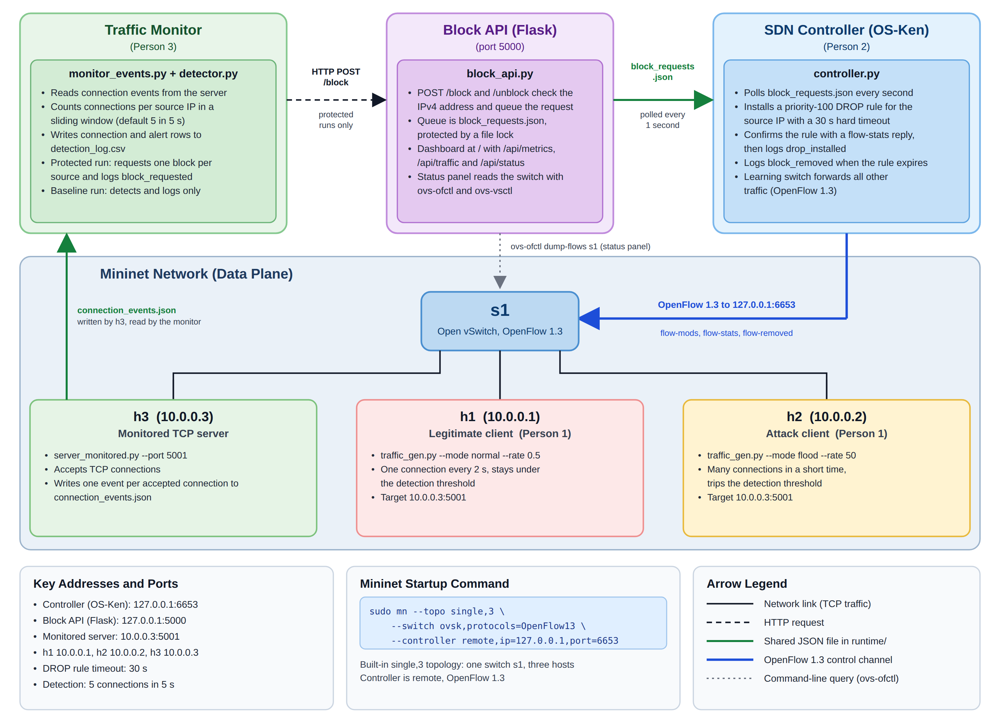
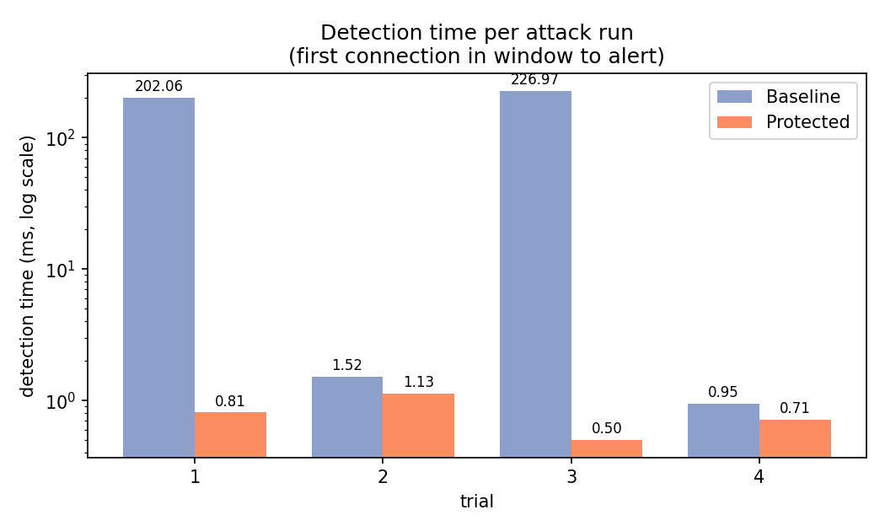
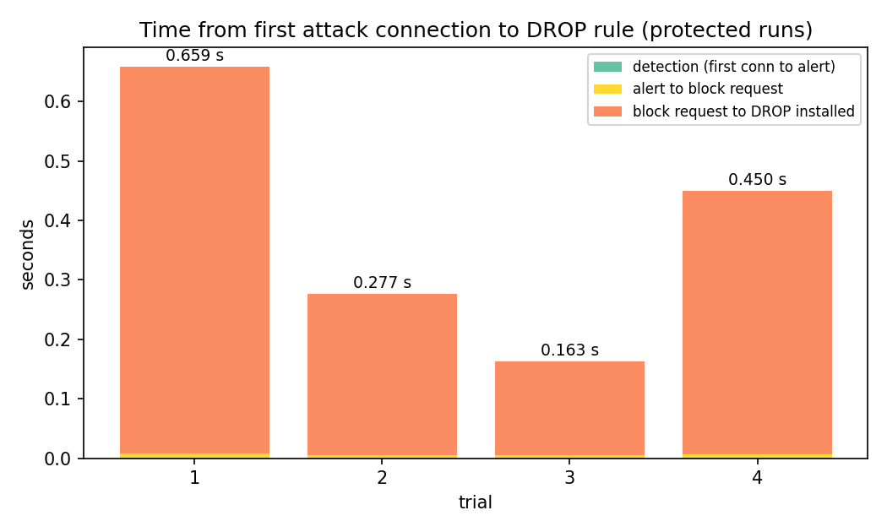

# SDN Attack Detection and Mitigation

A small Mininet and OpenFlow project that watches TCP connections to a server, flags any source that opens too many connections in a short window, and has the SDN controller drop that source's traffic for a while.

We built it as a group project for our Computer Networks course. Everything runs on one machine: Mininet for the network, an OS-Ken (Ryu fork) controller for the switch, and a few plain Python scripts for the server, the detector and the block API.



## How it works

```
 h1 / h2 ----> h3 (monitored TCP server, port 5001)
                |
                | writes one event per accepted connection
                v
        runtime/connection_events.json
                |
                v
        monitor_events.py + detector.py     counts connections per source IP
                |                           over a sliding window
                | POST /block  (protected runs only)
                v
        block_api.py (Flask, port 5000)
                |
                | appends to runtime/block_requests.json
                v
        controller.py (polls the queue every second)
                |
                | OpenFlow: priority-100 DROP rule, 30 s hard timeout
                v
        Open vSwitch s1
```

The pieces talk to each other through small JSON and CSV files in `runtime/`, guarded by file locks, instead of calling each other directly. That keeps the controller from having to know anything about detection.

The topology is `single,3`: one switch and three hosts.

| Host | Address | Role |
|------|---------|------|
| h1 | 10.0.0.1 | normal client |
| h2 | 10.0.0.2 | attacker |
| h3 | 10.0.0.3 | monitored server |

When the detector sees a source reach the threshold (5 connections in 5 seconds by default), it logs an `alert`. What happens next depends on the experiment condition set in `runtime/experiment_context.json`:

- `baseline`: detect and log only, never block.
- `protected`: ask the block API to block the source, once per source per monitor session.

The controller does not trust its own FlowMod. After sending the DROP rule it requests flow statistics from the switch and only logs `drop_installed` once the rule shows up in the reply. When the rule expires or is deleted it logs `block_removed`. The three events (`block_requested`, `drop_installed`, `block_removed`) go to `block_events.csv` with the run id, condition, scenario and trial, so the time from request to enforcement can be measured afterwards.

## Repository layout

```
sdn_defense/
    controller.py         OpenFlow 1.3 learning switch plus block/unblock handling
    block_api.py          Flask API and dashboard
    monitor_events.py     reads connection events, calls the detector, requests blocks
    detector.py           sliding-window connection counter
    server_monitored.py   TCP server that records every accepted connection
    paths.py              single place that defines every file location
    templates/dashboard.html
traffic/
    server.py             plain TCP server (no monitoring hook)
    client.py             TCP client with retries and timeouts
    traffic_gen.py        normal, flood and slow traffic generator
    test_all.py           test suite for the server, client and generator
analysis/
    analyze_results.py    turns the raw trial logs into summary tables and figures
tests/
    test_monitor.py       unit tests for the detector
config/
    detection_config.json threshold and window
    experiment_context.example.json
docs/
    architecture.png      system diagram (editable source: architecture.svg)
scripts/
    init_runtime.sh       creates runtime/ and the files the components share
results/                  raw logs, summary tables and figures from our experiment runs
```

`runtime/` is created on first use and is not tracked by git.

## Requirements

- Linux with Mininet and Open vSwitch installed
- Python 3.10 or newer
- Passwordless `sudo` for `ovs-ofctl` and `ovs-vsctl` if you want the status panel on the dashboard to work

```
python3 -m venv .venv
. .venv/bin/activate
pip install -r requirements.txt
```

Mininet hosts run as root, so the server on h3 needs the same Python packages as everything else. If you use a virtual environment, start Mininet with `sudo env PATH=$PATH mn ...` so the hosts pick up the same interpreter.

## Running it

Open one terminal per step, all from the repository root.

1. Prepare the shared files and set the experiment condition.

   ```
   ./scripts/init_runtime.sh
   nano runtime/experiment_context.json
   ```

   `condition` must be `baseline` or `protected`. The monitor refuses to start with anything else.

2. Start the controller.

   ```
   osken-manager sdn_defense/controller.py
   ```

3. Start the block API and dashboard.

   ```
   python3 sdn_defense/block_api.py
   ```

   The dashboard is at http://localhost:5000/.

4. Start Mininet.

   ```
   sudo mn --topo single,3 \
           --switch ovsk,protocols=OpenFlow13 \
           --controller remote,ip=127.0.0.1,port=6653
   ```

5. In the Mininet CLI, start the monitored server on h3.

   ```
   mininet> h3 python3 sdn_defense/server_monitored.py --port 5001 &
   ```

6. In another terminal, start the monitor.

   ```
   python3 -m sdn_defense.monitor_events
   ```

7. Generate traffic from the Mininet CLI using one of the scenarios below.

Restart the monitor between trials. Its per-source counters and the set of already-blocked sources live in memory.

## Experiment scenarios

Both scenarios target the monitored server at 10.0.0.3:5001 and are run from the Mininet CLI in the repository root.

**normal_only.** h1 sends steady, low-rate traffic for 60 seconds.

```
mininet> h1 python3 traffic/traffic_gen.py --host 10.0.0.3 --port 5001 --mode normal --rate 0.5 --duration 60
```

**normal_plus_attack.** The same h1 traffic, with h2 flooding the server for 10 seconds starting 10 seconds in.

```
mininet> h1 python3 traffic/traffic_gen.py --host 10.0.0.3 --port 5001 --mode normal --rate 0.5 --duration 60 &
mininet> sh sleep 10
mininet> h2 python3 traffic/traffic_gen.py --host 10.0.0.3 --port 5001 --mode flood --rate 50 --duration 10
```

h1 sends one connection every two seconds, which stays under the detection threshold, so only h2 is flagged. In a protected run the block lasts 30 seconds, so the 60-second window shows the block being installed and then expiring.

## Traffic tools

`traffic_gen.py` has four modes. Rate, duration, hold time and messages per connection can be overridden with flags.

| Mode | Default behaviour |
|------|-------------------|
| normal | 1 connection per second for 10 s, one PING each (the scenarios above use `--rate 0.5`) |
| flood | 50 connections per second for 10 s |
| slow | 5 connections per second for 20 s, each held open 2 s |
| custom | 1 per second for 10 s, set your own values |

At the end it prints how many connections were attempted, connected, failed (refused or reset) and blocked (timed out, which is what a DROP rule looks like from the client).

`server.py` speaks a line-based protocol: `HELLO <name>`, `ECHO <text>`, `PING`, `TIME`, `STATS` and `QUIT`. It enforces a client limit, an idle timeout and a 4096-byte line limit. `client.py` is a command-line client for it with retries.

## Configuration

`config/detection_config.json` holds the detection rule:

```
{ "threshold": 5, "window": 5 }
```

A source is suspicious once it has `threshold` connections within `window` seconds. If the file is missing or invalid the detector falls back to 5 and 5.0.

Two environment variables are available:

- `SDN_RUNTIME_DIR` moves the shared runtime directory (default `./runtime`).
- `SDN_DETECTION_CONFIG` points to a different detection config file.

Fixed values live in the code: the block lasts 30 seconds (`BLOCK_TIMEOUT` in `controller.py`), the block API listens on port 5000, and the monitor expects it at 127.0.0.1.

## Block API

| Endpoint | Method | Purpose |
|----------|--------|---------|
| `/health` | GET | liveness check |
| `/block` | POST | queue a block, body `{"ip": "10.0.0.2"}` |
| `/unblock` | POST | queue removal of a block |
| `/api/metrics` | GET | connection and alert counts from the detection log |
| `/api/traffic` | GET | the 30 most recent detection log rows |
| `/api/status` | GET | controller connection and currently blocked IPs, read from the switch |

`/block` and `/unblock` return 202 because they only queue the request. The controller picks it up within a second.

## Tests

The server, client and traffic generator have their own test suite. It starts a server on port 5055 and takes about a minute.

```
python3 traffic/test_all.py
```

It covers the command set, fragmented and pipelined messages, invalid input, abrupt disconnects, idle timeouts, the client limit, concurrent clients, and what the client and generator do when the server is down.

The detector has its own unit tests. They replay traffic with fixed timestamps, so they finish in about a second and never touch the real log.

```
python3 tests/test_monitor.py
```

They check the threshold and window behaviour, per-source tracking, alert de-duplication, config loading and fallbacks, log format, and the command-line argument checks.

`python3 sdn_defense/detector.py` sends three simulated connections and writes to `runtime/detection_log.csv`, which is handy for a quick manual check.

## Results

We ran 16 trials: baseline and protected conditions, normal-only and normal-plus-attack scenarios, four trials each. `analysis/analyze_results.py` rebuilds the tables and figures from the raw logs in `results/`.

```
python3 analysis/analyze_results.py
```

Summary for the four protected normal-plus-attack runs:

| Metric | Median | Range |
|--------|--------|-------|
| Detection time (first connection in window to alert) | 0.76 ms | 0.50 to 1.13 ms |
| Alert to block request | 5.6 ms | 4.5 to 6.5 ms |
| Block request to DROP installed | 0.36 s | 0.16 to 0.65 s |
| First attack connection to DROP installed | 0.36 s | 0.16 to 0.66 s |
| DROP installed to removed | 30.1 s | 30.09 to 30.21 s |

Across all 16 runs the legitimate host was never flagged, no block was requested in the normal-only runs, and no block was requested in the baseline attack runs. All four protected attack runs produced a block.





The full per-run numbers are in `results/results_per_run.csv` and `results/results_summary.csv`. File formats are described in `results/README.md`.

## Common issues

**Permission errors on files in `runtime/`.** The server on h3 runs as root and the other components usually do not. `scripts/init_runtime.sh` makes the shared files writable by everyone; if `runtime/` was created by root first, delete it and run the script again.

**The monitor exits immediately.** `condition` in `runtime/experiment_context.json` is missing or is not `baseline` or `protected`.

**`/api/status` returns 503.** The API could not run `sudo -n ovs-ofctl` or `ovs-vsctl`. The switch is expected to be named `s1` and the controller address `127.0.0.1:6653`.

## Team

The work was split three ways: sockets and traffic generation, the SDN controller and block API, and traffic monitoring and detection.
